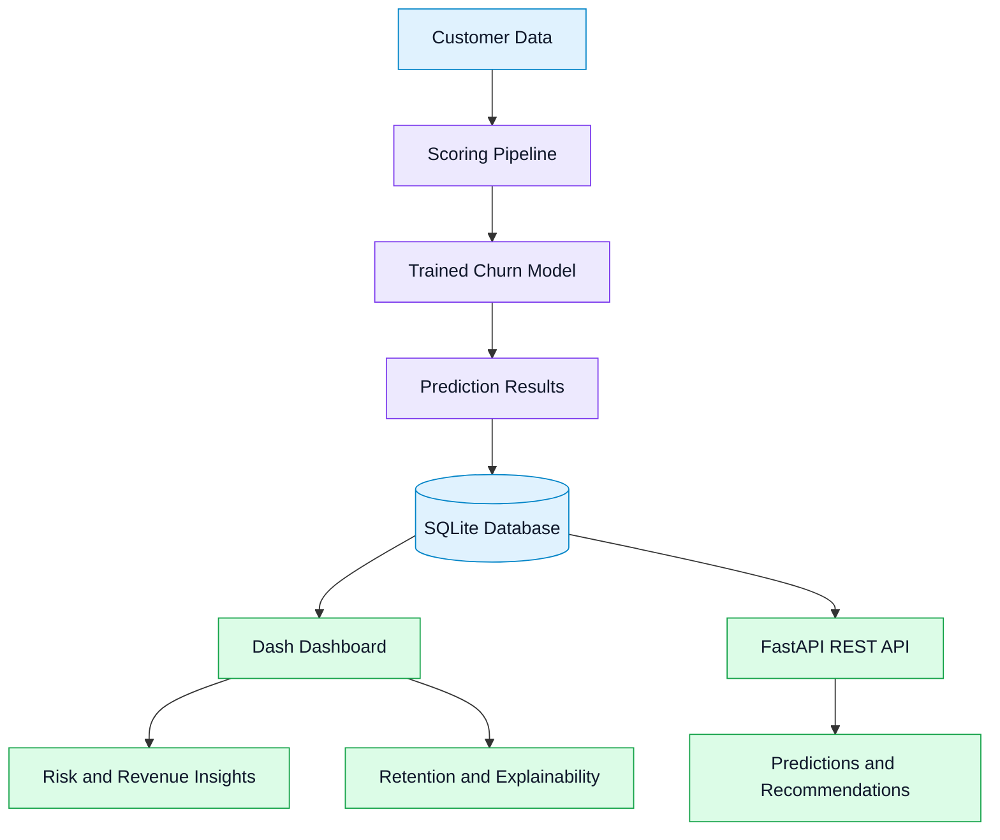

# 🚀 B2B Churn Early Warning System

<p align="center">
  <strong>Predict churn. Protect revenue. Retain customers.</strong>
  <br />
  An end-to-end Python application for customer churn intelligence, revenue risk analysis, retention recommendations, and explainable predictions.
</p>

<p align="center">
  
  
  
  
</p>

<p align="center">
  <a href="#-overview">Overview</a> •
  <a href="#-features">Features</a> •
  <a href="#-architecture">Architecture</a> •
  <a href="#-quick-start">Quick Start</a> •
  <a href="#-api-reference">API</a> •
  <a href="#-project-structure">Structure</a>
</p>

---

## 📌 Overview

Customer churn is more than a lost customer — it can mean lost recurring revenue, increased acquisition costs, and weaker long-term growth.

**B2B Churn Early Warning System** is a local-first analytics application designed to help businesses identify at-risk customers, understand potential revenue impact, and explore actionable retention strategies.

The project combines an interactive **Dash dashboard**, a **FastAPI REST API**, a SQLite database, and a prediction pipeline into one integrated workflow.

### 🎯 What can you do with it?

- 🔎 Identify customers who may be at risk of churning.
- 💰 Explore the potential business and revenue impact of churn.
- 🧭 Analyze customer journeys and behavioral patterns.
- 💡 Review retention recommendations for at-risk customers.
- 🧠 Explore explanations behind model predictions.
- ⚙️ Run scoring and monitoring jobs to refresh predictions.

> [!NOTE]
> This is a locally running application. The dashboard and API use your local database and are not publicly hosted by default.

## ✨ Features

<details open>
<summary><strong>📊 Interactive Analytics Dashboard</strong></summary>

Explore the application's dashboard through dedicated analytical views:

- **Overview:** A high-level view of customer and churn indicators.
- **Risk Analysis:** Investigate customer churn risk.
- **Business Impact:** Examine potential revenue exposure.
- **Retention Prescriptions:** Explore suggested retention actions.
- **Customer Journeys:** Analyze customer journey patterns.
- **Explainability:** Understand prediction explanations.

</details>

<details>
<summary><strong>⚡ REST API with FastAPI</strong></summary>

The API provides endpoints for supported application capabilities, including:

- Customer churn predictions.
- Retention recommendations.
- Prediction explanations.
- System metrics.

Interactive API documentation is available through Swagger UI when the API is running.

</details>

<details>
<summary><strong>🤖 Prediction Pipeline</strong></summary>

Run scoring jobs to update predictions stored in the local SQLite database.

- One-time scoring execution.
- Daily scheduling through a persistent process.
- Database-backed prediction results.
- Monitoring scripts for the prediction workflow.

</details>

<details>
<summary><strong>🗄️ Local Data Storage</strong></summary>

The application uses SQLite to store sample customer and prediction data.

The dashboard and API read from:

`data/churn_system.db`

</details>

## 🏗️ Architecture



### 🧰 Technology Stack

| Component | Technology | Purpose |
|---|---|---|
| Language | Python 3.11+ | Application and ML workflows |
| Dashboard | Dash | Interactive analytics interface |
| API | FastAPI | Prediction and insight endpoints |
| Database | SQLite | Local customer and prediction storage |
| ML | Trained churn model | Customer risk scoring |
| Pipeline | Python scheduler | Scoring and periodic updates |

## 🚀 Quick Start

### 1. Prerequisites

- Python 3.11 or newer
- Git
- A terminal such as PowerShell, Command Prompt, or macOS/Linux Terminal

### 2. Clone the repository

```bash
git clone https://github.com/arijeet2006/B2B.git
cd B2B
```

### 3. Create a virtual environment

**Windows PowerShell**

```powershell
python -m venv .venv
.\.venv\Scripts\Activate.ps1
```

**Windows Command Prompt**

```bat
python -m venv .venv
.venv\Scripts\activate.bat
```

**macOS / Linux**

```bash
python3 -m venv .venv
source .venv/bin/activate
```

### 4. Install dependencies

```bash
python -m pip install --upgrade pip
python -m pip install -r requirements.txt
```

If your setup requires the full dashboard, API, and ML dependency set, install the full requirements file instead:

```bash
python -m pip install -r requirements_full.txt
```

### 5. Launch the dashboard

```bash
python run.py
```

Open the application:

**[http://127.0.0.1:8050](http://127.0.0.1:8050)**

Press `Ctrl + C` in the terminal to stop the dashboard.

## ⚡ Run the REST API

Open a second terminal in the project directory and activate the same virtual environment.

Start the API:

```bash
python src/api.py
```

| Resource | Local URL |
|---|---|
| API base | [127.0.0.1:8000](http://127.0.0.1:8000) |
| Swagger UI | [127.0.0.1:8000/docs](http://127.0.0.1:8000/docs) |
| ReDoc | [127.0.0.1:8000/redoc](http://127.0.0.1:8000/redoc) |

Use Swagger UI to inspect and test the endpoints exposed by your running API.

> [!TIP]
> Run the dashboard and API in separate terminals so both services can remain active simultaneously.

## 🔄 Run the Prediction Pipeline

### Execute scoring once

```bash
python src/scheduler.py once
```

This runs the scoring pipeline once to update predictions in the local database.

### Start the daily scheduler

```bash
python src/scheduler.py
```

Keep the scheduler running in a separate terminal if you want it to refresh predictions automatically.

**Data flow:** Scoring pipeline → SQLite database → Dashboard and API.

## 📁 Project Structure

```text
B2B/
├── data/
│   └── churn_system.db       # Sample data and prediction database
├── models/
│   └──                       # Trained churn model
├── notebooks/
│   └──                       # Exploration and model development
├── src/
│   ├── app.py                # Dash dashboard
│   ├── api.py                # FastAPI application
│   └── scheduler.py          # Scoring and scheduling
├── run.py                    # Dashboard startup script
├── requirements.txt          # Local dependencies
├── requirements_full.txt     # Full dependency set
└── README.md
```

## 🔌 API Reference

The following capabilities are available through the API, subject to the endpoints implemented in your application:

| Capability | Description |
|---|---|
| Predictions | Request churn prediction results |
| Recommendations | Retrieve retention suggestions |
| Explanations | Inspect prediction explanations |
| System metrics | Access supported operational metrics |

For the exact endpoint paths, request schemas, and response formats, open **[Swagger UI](http://127.0.0.1:8000/docs)** after starting the API.

## 🧪 Suggested Workflow

1. **Start the application** using `python run.py`.
2. **Inspect customer risk** in the dashboard.
3. **Explore business impact** to understand potential revenue exposure.
4. **Review retention recommendations** for customers who may need attention.
5. **Investigate prediction explanations** to understand model outputs.
6. **Refresh predictions** using the scoring pipeline when required.

## 🔒 Local Development and Data

- The project is designed to run locally.
- The SQLite database is stored under `data/`.
- The dashboard and API depend on the application's local data and configuration.
- Keep credentials, API keys, and sensitive customer information out of public commits.
- Avoid committing virtual environments, caches, secrets, or other generated files.

## 🛣️ Future Improvements

Potential enhancements for future iterations include:

- [ ] Live model performance monitoring.
- [ ] Automated drift and data-quality checks.
- [ ] Configurable churn-risk thresholds.
- [ ] Customer-level prediction history.
- [ ] Authentication and role-based API access.
- [ ] Deployment with Docker.
- [ ] Automated testing and continuous integration.

## 🤝 Contributing

Contributions, bug reports, and improvement suggestions are welcome.

1. Fork the repository.
2. Create a feature branch.
3. Make and test your changes.
4. Submit a pull request describing your improvements.

## 📄 License

No license has been specified here. Add a `LICENSE` file if you intend to define how others may use, modify, or distribute this project.

---

<p align="center">
  <strong>Built for smarter customer retention and data-driven decisions.</strong>
  <br />
  <a href="https://github.com/arijeet2006/B2B">Explore the Repository</a>
</p>
